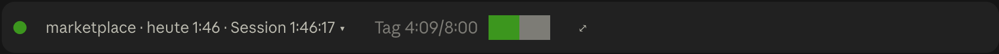
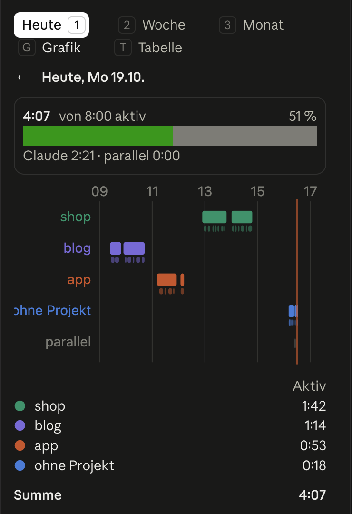
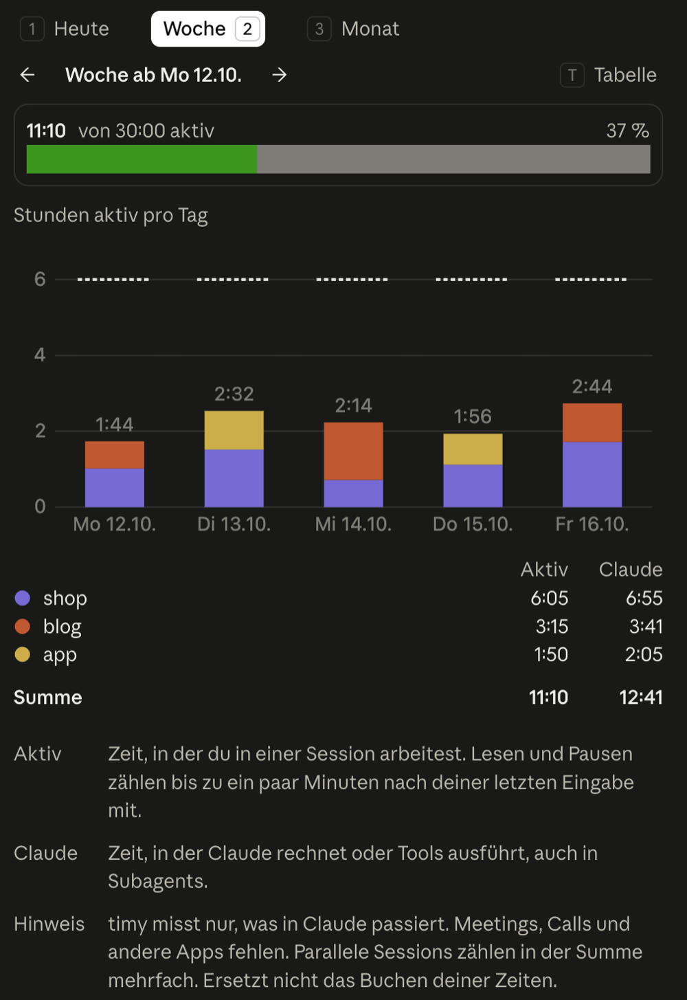

# timy

timy shows you how much time you spend per project in your Claude sessions. It is meant for yourself, not as a timesheet and not for control: the data stays on your machine and timy sends nothing anywhere.

Above the prompt there is a band with the project, today's time and the day against your target. Click it to see today per project, `⤢` opens the pane. `/timy` opens the pane too, with today, the week and the month (keys `1`, `2`, `3`). In the desktop app the pane switches between a chart and a table (`g`, `t`), the terminal shows the table. A few lines at the foot of the pane say what the two times mean. The interface is in German, the pictures show demo data plus the session that took them.



| Today | A week |
|---|---|
|  |  |

## How it counts

timy notes a few events per session: when you open it, type, send something and when Claude is done, and once a minute when Claude worked. Two times come out of that. `Aktiv` keeps counting for up to `idle_minutes` after you open the session, type or send something; Claude working on its own does not keep it going. Closing the session stops it at once. `Claude` counts while a model request or a tool runs, subagents included, at most 15 minutes per run; a question to you or a plan waiting for your approval does not count, a turn that just stays open does not either. timy also notes how long you type in the prompt, but does not show it.

The count is rough and covers only what happens inside Claude. Meetings, calls and other apps are missing, so it does not replace booking your time.

If two sessions run at the same time, the time counts in each of their projects. The table then shows under `Summe` how much of it was `parallel`, the number at the top counts it only once.

The project is the path from the git remote, for example `firma/shop`. Without a remote it is the folder name of the repository, outside a git repository `ohne Projekt`. A day starts at 4 am, so work after midnight still counts for the day before.

## Where the data lives

One file per session and day under `~/.claude/timy`, one line per event:

```json
{"t":"2026-10-15T09:24:00.000Z","type":"submit","project":"firma/shop","session":"3f2a9c1e-5b7d-4e8a-9c21-6d0f4b8a7e13","branch":"feature/12-login","title":"#12 Login page"}
```

Beside it `<session>.claude.jsonl` holds at most one line per minute with the stretches in which Claude worked, as start and end in milliseconds:

```json
{"t":"2026-10-15T09:25:03.000Z","type":"claude","project":"firma/shop","session":"3f2a9c1e-5b7d-4e8a-9c21-6d0f4b8a7e13","ranges":[[1792056303000,1792056341000]]}
```

Next to them `colors.json` remembers which colour each project has in the charts. Neither prompts nor answers are stored. If you want to start over, delete the folder.

## Install

1. Add the marketplace: `/plugin marketplace add https://github.com/naymspace/claude-marketplace.git`
2. Install timy: `/plugin install timy@naymspace-marketplace`
3. Run `/reload-plugins`

timy works without any setup.

## Settings

Change them with `/plugin configure timy@naymspace-marketplace`.

| Option | Default | What it does |
|---|---|---|
| `idle_minutes` | `3` | Minutes without input after which `Aktiv` stops counting |
| `data_dir` | `~/.claude/timy` | Folder for the data |
| `hours_per_weekday` | no target | Your target Monday to Sunday, for example `8,8,8,8,8` |
